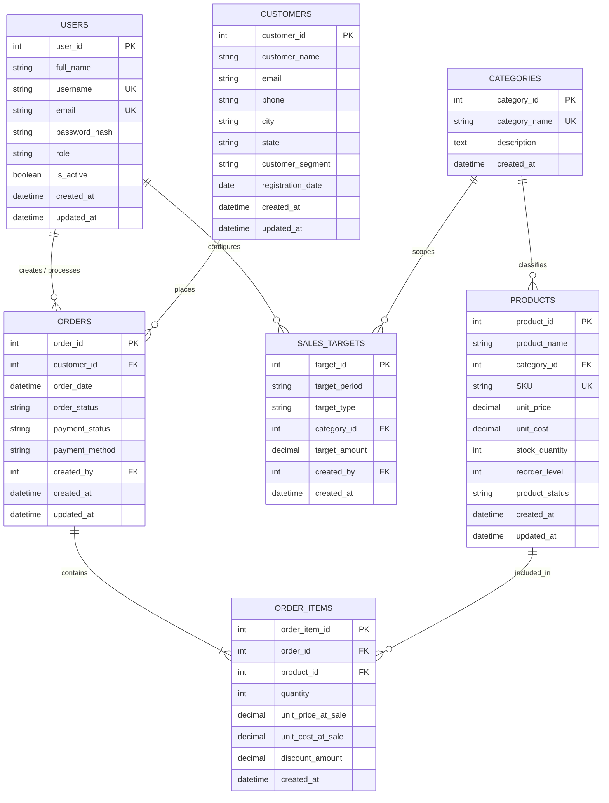

# Entity-Relationship (ER) Diagram

The following Mermaid diagram visualizes the relational schema of the **Business Sales Intelligence and Revenue Analytics System** (`business_sales_intelligence`), illustrating entity relationships, foreign key constraints, and cardinalities.

---

## Relationship Cardinality & Integrity Rules

1. **`CUSTOMERS` to `ORDERS` (1 : N)**
   - Cardinality: One customer can place zero or many orders. Each order must reference exactly one customer.
   - Referential Action: `ON DELETE RESTRICT` (Customers with historical transactions cannot be deleted, preserving transactional integrity).

2. **`CATEGORIES` to `PRODUCTS` (1 : N)**
   - Cardinality: One category contains zero or many products. Each product belongs to exactly one category.
   - Referential Action: `ON DELETE RESTRICT` (Categories cannot be deleted if products are assigned).

3. **`ORDERS` to `ORDER_ITEMS` (1 : N)**
   - Cardinality: One order contains one or many line items. Each line item belongs strictly to one parent order.
   - Referential Action: `ON DELETE CASCADE` (Deleting an uncommitted or draft order safely cascades to its constituent line items).

4. **`PRODUCTS` to `ORDER_ITEMS` (1 : N)**
   - Cardinality: One product can appear in multiple line items across different historical orders.
   - Referential Action: `ON DELETE RESTRICT` (A product cannot be deleted if historical sales records reference its SKU).

5. **`USERS` to `ORDERS` (1 : N)**
   - Cardinality: A sales employee or admin user creates/processes zero or many orders.
   - Referential Action: `ON DELETE SET NULL` (If a user account is deleted or pruned, historical orders preserve their audit trail with `created_by` set to NULL).

6. **`CATEGORIES` to `SALES_TARGETS` (1 : N)**
   - Cardinality: A target may be scoped to a specific category or represent overall monthly performance (`category_id IS NULL`).
   - Referential Action: `ON DELETE SET NULL`.
